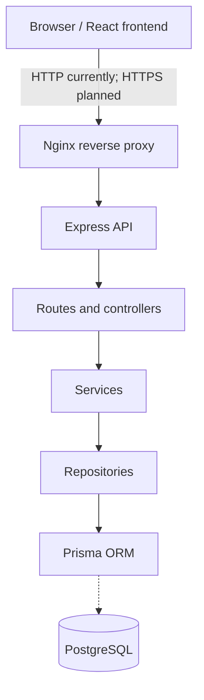

# Application Architecture 

**Versión:** Maroma  
**Date:** 2026-10-26

## 1. Overview

ft_transcendence is being developed as a web application with a React frontend, an Express backend and a PostgreSQL database. The application is being developed as a social platform with user accounts, authentication, publications, comments, categories, likes, and follower relationships. 

The repository separates frontend, backend and Nginx configurations, with Docker Compose coordinating the available services.

The architecture follows a layered backend design, uses REST-oriented API communication, and relies on Prisma for database access.

## 2. Technology Stack

| Area | Technology | Current status |
| --- | --- | --- |
| Frontend | React 19, TypeScript, Vite | Application structure and initial pages present |
| Routing | React Router 8 | Client-side routes and layouts implemented |
| Styling | Tailwind CSS 4 | integrated into the frontend project |
| Backend | Express 5, TypeScript | Server, routes, controllers, and services present |
| Database | PostgreSQL 17 | Docker Compose service defined |
| ORM | Prisma 7 | Client, schema, migration, and repositories present |
| Validation | Zod 4 | Backend request schemas implemented |
| API documentation | OpenAPI 3.1.2 | Status and session endpoints documented |
| Infrastructure | Docker Compose and Nginx | HTTP reverse proxy and database infrastructure configured |

## 3. High-Level Architecture

The application is organized into three main areas:

- **Frontend**: React application responsible for the user interface and client-side navigation.

- **Backend**: Express API responsible for request processing, validation, business logic, authentication, and database operations.

- **Database**: PostgreSQL, accessed through Prisma ORM.

The intended request flow is:



## 4. Frontend Architecture

The frontend is implemented using React, TypeScript, Vite, React Router, and Tailwind CSS.

It follows a page-based structure with shared layouts and client-side routing.

### Main Components

| Component | Responsibility |
|---|---|
| `src/app/router.tsx` | Defines client-side routes and layout hierarchy |
| `src/layouts/AuthLayout.tsx` | Shared layout for authentication pages |
| `src/layouts/MainLayout.tsx` | Main application layout and navigation |
| `src/pages/auth/LoginPage.tsx` | Login interface |
| `src/pages/auth/RegisterPage.tsx` | Registration interface |
| `src/pages/home/HomePage.tsx` | Initial home page |
| `src/services/auth.ts` | Provisional authentication service functions |
| `src/main.tsx` | Frontend application entry point |

### Application Routes

| Route | Page | Layout |
|---|---|---|
| `/` | HomePage | MainLayout |
| `/login` | LoginPage | AuthLayout |
| `/register` | RegisterPage | AuthLayout |

## 5. Backend Architecture

The backend uses Express 5 and TypeScript and follows a layered architecture:

```text
routes -> controllers -> services -> repositories -> database
```

### Layer Responsibilities

**Routes**

Define HTTP endpoints and connect them to controllers. Resource routes are grouped under `src/routes/api/` and registered through `src/routes/apiRoutes.ts`.

**Controllers**

Handle HTTP requests, validate incoming data, invoke services, and construct HTTP responses.

**Services**

Implement business logic independently of HTTP handling. Current services include user registration, credential verification, password hashing, and session management.

**Repositories**

Encapsulate database access and separate business logic from persistence operations.

**Database**

Provides PostgreSQL connectivity through the Prisma client.

### Supporting Components

| Directory | Responsibility |
|---|---|
| `schemas/` | Request validation with Zod |
| `middleware/` | Cookie parsing, session loading, and authentication checks |
| `errors/` | Application-specific error definitions |
| `types/` | Shared TypeScript types and interfaces |
| `constants/` | Shared configuration values |
| `utils/` | Reusable utility functions |
| `db/` | Database configuration, Prisma schema, migrations, and seed data |

### Implemented Route Definitions

| Method | Endpoint | Purpose |
|---|---|---|
| GET | `/health` | Backend health check |
| GET | `/api/status` | API status |
| POST | `/api/users` | User registration |
| POST | `/api/sessions` | Create a session |
| GET | `/api/sessions` | List user sessions |
| DELETE | `/api/sessions/current` | Close the current session |
| DELETE | `/api/sessions/:id` | Close a specific session |
| DELETE | `/api/sessions` | Close all user sessions |

## 6. API Communication and Contracts

The application uses a REST-oriented API with resource-based endpoints and standard HTTP methods.

Application endpoints are grouped under the `/api` base path.

The team follows conventions for endpoint naming, request validation, HTTP status codes, and JSON response structures.

### API Documentation

The API contract is maintained in [`docs/openapi.yaml`](./openapi.yaml), using OpenAPI 3.1.2.

The current specification documents:

- `GET /api/status`
- `POST /api/sessions`
- `GET /api/sessions`
- `DELETE /api/sessions/current`
- `DELETE /api/sessions/{id}`
- `DELETE /api/sessions`

The backend also defines `POST /api/users`, but this endpoint is not yet included in the OpenAPI specification.

The `/health` endpoint is used for backend health checks and is not currently documented in OpenAPI.

### Response Conventions

The agreed API conventions use a `data` envelope for successful JSON responses.

```json
{"data": {"status": "ok"}}
```

```json
{"error": {"code": "VALIDATION_ERROR", "message": "The request contains invalid fields.", "details": {"name": "Name is required."}}}
```

These examples describe the agreed response conventions. Consistent implementation across all endpoints is still pending.

### Authentication Contract

Authentication uses database-backed sessions identified through an HTTP cookie.

The OpenAPI specification defines the `sessionCookie` security scheme for protected endpoints.

Session creation, retrieval, and deletion are represented in the API contract.

## 7. Database and Prisma

PostgreSQL is the agreed database, with Prisma 7 as ORM. Docker Compose defines a PostgreSQL 17 service, an internal network, a persistent `db` volume and readiness checks.

### Database Models

The schema is defined in:

`backend/src/db/prisma/schema.prisma`

The current schema contains eight models:

| Model | Responsibility |
|---|---|
| `User` | User accounts, credentials, and profile information |
| `Session` | Authentication sessions and expiration data |
| `Follow_up` | Follower relationships between users |
| `Post` | User-generated publications |
| `Category` | Publication categories |
| `PostCategory` | Many-to-many relationship between posts and categories |
| `Comments` | Comments and nested replies |
| `PostLike` | Likes associated with publications |

The schema includes primary keys, unique constraints, relationships, indexes, and cascading deletion rules.

These models provide the data foundation for the social application.

### Prisma Configuration

The Prisma client is configured in:

`backend/src/db/prisma/prisma.ts`

It uses the PostgreSQL adapter and obtains its connection string from the `DATABASE_URL` environment variable.

Prisma CLI configuration is maintained in:

`backend/prisma.config.ts`

### Migrations and Seed Data

An initial SQL migration is present under:

`backend/src/db/prisma/migrations/`

A seed file is also present:

`backend/src/db/seed.ts`

The seed configuration and compatibility with the current password hashing mechanism require verification.

### Repository Implementation

The session repository implements database operations for:

- Creating sessions.
- Finding sessions by user ID.
- Finding sessions by token hash.
- Deleting individual sessions belonging to a user.
- Deleting all sessions belonging to a user.

### Database Development Conventions

The agreed team workflow is:

- Each developer maintains a local development database.
- Schema changes and their corresponding migrations are committed together.
- Developers apply migrations to synchronize their local databases.
- Already-committed migrations should not be modified; corrections require new migrations.
- Shared seed data is maintained in the designated seed file.
- Deployment environments apply existing migrations rather than generating development migrations.

### Pending Verification

- Apply the initial migration in a clean environment.
- Complete the user repository implementation.
- Verify database persistence through the running backend.
- Validate seed execution and test credentials.
- Confirm database integration through automated or manual tests.

## 8. Containers, Networking and Deployment

The current `docker-compose.yml` defines three services:

| Service | Responsibility | Current implementation |
| --- | --- | --- |
| `nginx` | Public-facing reverse proxy | Publishes host port 80 and proxies to backend |
| `backend` | Express API | Runs on internal configured port; joins `internal` and `external` networks |
| `database` | PostgreSQL persistence | Uses internal network and persistent Docker volume |

### Networking

Two Docker bridge networks are configured:

- `external`: Connects Nginx and the backend.
- `internal`: Connects the backend and PostgreSQL.

The PostgreSQL container is not directly attached to the external network.

### Service Dependencies

Docker Compose defines health checks for the backend and database.

The backend depends on the database being healthy, and Nginx depends on the backend being healthy.

These checks coordinate service startup but do not establish that all application features work correctly.

### Backend Container

The backend Dockerfile uses Node.js 26, installs dependencies, generates the Prisma client, and starts the Express application.

Prisma client generation does not replace the need to apply database migrations.

### Deployment Limitations

The current configuration remains development-oriented.

- Nginx listens on port 80 without HTTPS.
- Incoming requests are forwarded to the backend.
- The React application is not yet served as compiled static assets by Nginx.
- Docker Compose does not define a frontend service.
- Complete browser-to-API deployment has not been verified.

The intended deployment includes HTTPS and static frontend hosting. These capabilities remain pending.

## 9. Security Boundaries

**Password hashing**

User passwords are processed using Argon2id.

**Session tokens**

Session tokens are generated using cryptographically secure random bytes.

Tokens are hashed using SHA-256 before database storage.

**Session cookies**

Session cookies use the `HttpOnly` attribute.

The configured session lifetime is seven days.

**Input validation**

Zod schemas validate registration and session requests.

**Authentication middleware**

Protected session endpoints require an authenticated user and an active session context.

**Infrastructure separation**

PostgreSQL is connected only to the internal Docker network.

**Environment files**

The repository's `.gitignore` excludes `.env` files while allowing `.env.example`.

## 10. Open Decisions and Verification Items

| Topic | Status / next action |
|---|---|
| Application domain model | Initial social platform schema present; feature integration pending |
| User registration | Controller, validation, and service present; repository implementation pending |
| Authentication mechanism | Database-backed session approach established |
| Session management | Routes, services, and repository present; end-to-end verification pending |
| Centralized error handling | Pending integration |
| API contract consistency | Document registration and align response formats |
| Frontend authentication | Pages present; API communication pending |
| Prisma migrations | Initial migration present; clean-environment verification pending |
| Database seed | Present; configuration and password compatibility require verification |
| HTTPS | Not implemented |
| Frontend static hosting | Not configured in Nginx |
| Security hardening | Cookie policy |
| Deployment verification | Build containers and test complete application flows |

## 11. Related Documents and Team Review

- [`../README.md`](../README.md): project overview, team roles and high-level stack.
- [`../CONTRIBUTING.md`](../CONTRIBUTING.md): branching and PR review practices.
- [`./openapi.yaml`](./openapi.yaml): API contract source of truth.
- [`../backend/src/db/prisma/schema.prisma`](../backend/src/db/prisma/schema.prisma): Database models and relationships.
- [Notion architecture task](https://app.notion.com/p/3f8fac1d1ce7807f8980e8dd14645424).
- Discord documentation

### Review Responsibilities

The architecture document should be reviewed whenever significant changes affect:

- The technology stack or application structure.
- API contracts or authentication.
- Database models or persistence.
- Infrastructure, networking, or deployment.
- Security boundaries.

Reviews should involve the Technical Lead and the developers responsible for the affected components.
