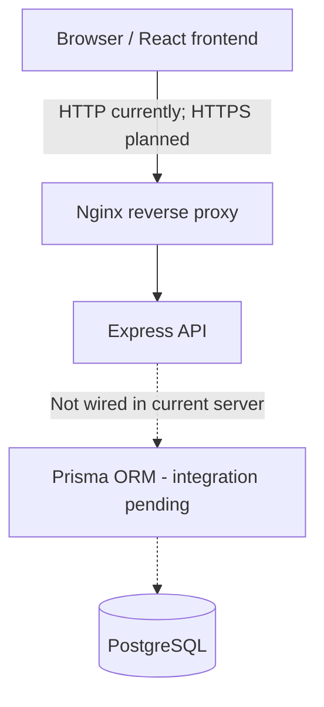

# Application Architecture

## 1. Overview

ft_transcendence is being developed as a web application with a React frontend, an Express backend and a PostgreSQL database. The repository separates frontend, backend and Nginx configurations, with Docker Compose coordinating the available services.

This document distinguishes **implemented**, **agreed/planned**, and **pending** elements. The current repository is an initial scaffold, not a finished deployment.

## 2. Technology Stack

| Area | Technology | Current status |
| --- | --- | --- |
| Frontend | React, TypeScript, Vite | Initial project present |
| Routing | React Router | Initial root route present |
| Styling | Tailwind CSS | Dependencies present |
| Backend | Express 5, TypeScript source files | Initial server and routes present |
| Database | PostgreSQL 17 | Docker Compose service defined |
| ORM | Prisma 7 | Dependencies present; operational integration pending |
| Validation | Zod | Agreed in team documentation; integration not yet verified |
| API documentation | OpenAPI 3.1.2 | Initial `/status` contract present |
| Infrastructure | Docker Compose and Nginx | Initial configuration present; HTTPS not yet configured |

## 3. High-Level Architecture



**Important current limitation:** Docker Compose defines `nginx`, `backend`, and `database`, but no separate frontend service or frontend static-file mount. The current Nginx configuration proxies `/` to the backend over port 80; it does not yet serve the built React application.

## 4. Frontend Architecture

The frontend code is under `frontend/` and currently contains:

- `src/app/router.tsx`: React Router configuration.
- `src/pages/Index.tsx`: initial page for displaying backend status.
- `src/services/api.ts`: placeholder for the frontend API client.
- `src/main.tsx`: application entry point.

The team-proposed directory structure also includes `components`, `layouts`, `hooks`, `utils`, `assets`, and `styles`. These must not be described as existing directories unless added to `develop`.

## 5. Backend Architecture

The agreed application layering is:

```text
routes -> controllers -> services -> repositories -> database
```

Responsibilities agreed in the Discord documentation:

- **Routes:** Register Express endpoints and group resource routes in `src/routes/api/*` via `src/routes/apiRoutes.ts`.
- **Controllers:** Receive HTTP requests and return HTTP responses.
- **Services:** Encapsulate business logic.
- **Repositories:** Encapsulate direct database operations, using Prisma when connected.
- **db:** Database client and connection configuration.
- **middleware:** Shared Express middleware, including prospective authentication and error handlers.
- **errors:** Shared application error types.
- **schemas:** Validation and data schemas, subject to final implementation conventions.

The current branch contains `controllers`, `db`, `repositories`, `routes`, and `index.ts`. The `services`, `middleware`, `errors`, and `schemas` directories remain proposed, not verified as implemented.

## 6. API Communication and Contracts

The team has agreed to resource-oriented REST routes with lowercase, descriptive, hyphen-separated names, and standard HTTP methods (`GET`, `POST`, `PUT`, `PATCH`, `DELETE`). `GET` must not mutate server state.

The agreed JSON response envelopes are:

```json
{"data": {"status": "ok"}}
```

```json
{"error": {"code": "VALIDATION_ERROR", "message": "The request contains invalid fields.", "details": {"name": "Name is required."}}}
```

The API contract is maintained in [`docs/openapi.yaml`](./openapi.yaml), using OpenAPI 3.1.2. Endpoint-changing PRs must update that contract and receive frontend/backend review.

The current OpenAPI file documents `GET /api/status`; the backend implementation also includes `/health`. The frontend transport and public API base-path strategy should be checked against the final proxy setup.

## 7. Database and Prisma

PostgreSQL is the agreed database, with Prisma 7 as ORM. Docker Compose defines a PostgreSQL 17 service, an internal network, a persistent `db` volume and readiness checks.

**.............In progress............** 

The agreed database teamwork procedure is:

- Each developer maintains their own local database.
- Commit `schema.prisma` and new files under `prisma/migrations/` together.
- Run `prisma migrate dev` for local development and `prisma generate` after pulling changes when required.
- Never alter already-pushed migrations; add new migrations for corrections.
- Use `prisma/seed.ts` for shared seed data when provided.
- Use `prisma migrate deploy` for deployment environments.

These are team conventions, not a claim that the corresponding schema, migrations or seed files already exist in `develop`.

## 8. Containers, Networking and Deployment

The current `docker-compose.yml` defines three services:

| Service | Responsibility | Current implementation |
| --- | --- | --- |
| `nginx` | Public-facing reverse proxy | Publishes host port 80 and proxies to backend |
| `backend` | Express API | Runs on internal configured port; joins `internal` and `external` networks |
| `database` | PostgreSQL persistence | Uses internal network and persistent Docker volume |

Compose defines health checks for backend and database, and orders service start-up using healthy dependencies. Nginx currently listens on port 80 and forwards `/` to the backend. The Discord plan anticipates HTTPS on port 443, with the frontend built as static assets rather than requiring a continuously running frontend server. That target is **not yet implemented** in the reviewed Nginx/Compose files.

The repository includes a root `Makefile`; deployment behavior and a one-command operational setup should be validated rather than assumed from the file's existence.

## 9. Security Boundaries

The project subject requires HTTPS for connections to the backend from browsers or other external clients, validation on frontend and backend, and `.env` files excluded from Git with a safe `.env.example` committed. The team's agreed stack includes Zod for validation, but its implementation is not confirmed in the current package manifests.

Do not claim that authentication, authorization, production TLS termination, or centralized error handling is implemented until confirmed in the relevant branches and team reviews.

## 10. Open Decisions and Verification Items

| Topic | Status / next action |
| --- | --- |
| MVP scope and application-specific domain model | Pending team agreement |
| Initial `User` fields | Coordinate with the Prisma task and register/login owners |
| Authentication mechanism | Decide as a team: session-based or token-based approach, including storage and lifecycle |
| Prisma connectivity and migrations | In progress; verify after the relevant task is merged |
| HTTPS and static frontend hosting | Align Docker/Nginx implementation with agreed HTTPS/443 target |
| Running system verification | Build/start containers and test browser-to-API flow before marking operational claims complete |

## 11. Related Documents and Team Review

- [`../README.md`](../README.md): project overview, team roles and high-level stack.
- [`../CONTRIBUTING.md`](../CONTRIBUTING.md): branching and PR review practices.
- [`./openapi.yaml`](./openapi.yaml): API contract source of truth.
- [Notion architecture task](https://app.notion.com/p/3f8fac1d1ce7807f8980e8dd14645424).
- Discord documentation

**Review required:** Confirm accuracy against the latest `develop` branch with the Technical Lead, the frontend owner and the Prisma/database task owner. Keep technical disagreements listed as unresolved decisions until agreed; this document should not silently override existing conventions.
